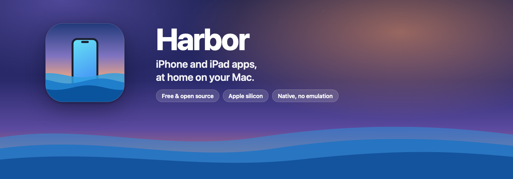

<p align="center">
  
</p>

<p align="center">
  <a href="https://github.com/harkhowalia-1/Harbor/releases/latest"></a>
  <a href="https://github.com/harkhowalia-1/Harbor/releases"></a>
  
  
  <a href="LICENSE"></a>
</p>

<p align="center">
  <a href="https://github.com/harkhowalia-1/Harbor/releases/latest/download/Harbor.dmg"><b>Download for Mac</b></a> ·
  <a href="https://harkhowalia-1.github.io/Harbor/"><b>Website</b></a> ·
  <a href="#how-it-works"><b>How it works</b></a>
</p>

# Harbor

Harbor turns an iPhone or iPad app package (`.ipa`) into a real Mac app in `/Applications`.
Each converted app runs natively on Apple silicon with its own window, Dock icon, Launchpad
entry, Spotlight result and sandboxed save data. A small runtime injected into every app fixes
what iOS apps assume about their device: identity, screen, keychain, motion sensors, touch input
and game controllers.

Harbor converts **decrypted** packages only: your own builds, ad-hoc or enterprise builds, and
open-source apps. App Store downloads are FairPlay-encrypted; Harbor detects that and refuses.

## Install

Download [Harbor.dmg](https://github.com/harkhowalia-1/Harbor/releases/latest/download/Harbor.dmg), open it and drag
Harbor to Applications. Releases are signed ad hoc, so the first time you open Harbor macOS can't verify
it: go to System Settings › Privacy & Security and click Open Anyway. Harbor needs an Apple silicon Mac
with macOS 14 or later. It doesn't need Xcode or a developer account.

## Build

Building from source requires an Apple silicon Mac with Xcode (tested with macOS 27 and Xcode 27).

```bash
scripts/build.sh
```

This produces `dist/Harbor.app`, which bundles the library app, the `harbor` command-line tool
(`Harbor.app/Contents/Resources/bin/harbor`) and the runtime libraries. `scripts/package-dmg.sh` then
signs it and wraps it in `dist/Harbor.dmg`. CI does both on every push to `main` and publishes the
release named in `VERSION`. `scripts/make-graphics.sh` redraws the icon, banner, social image and
disk image background from `docs/graphics`.

## Use

Drop an `.ipa` on Harbor's window or Dock icon, or open it with Harbor from Finder. Harbor shows a
compatibility report, then converts and installs the app. Per-app settings live in the library window.

From the terminal:

```bash
harbor inspect MyGame.ipa               # compatibility check, no changes
harbor convert MyGame.ipa               # convert and install into /Applications
harbor convert MyGame.ipa --device ipad-air-11-m2 --name "My Game"
harbor settings "My Game" --orientation landscape --motion controller
harbor settings "My App" --aspect free  # resizable window of any shape
harbor list
harbor remove "My Game" --delete-data   # app, container and settings go to the Trash
```

Inside a converted app:

| Shortcut | Action |
| --- | --- |
| ⌘⇧K | Keymap editor over the live app: click to add a button, drag to move, press a key or controller button to bind, ⌫ deletes, Esc saves |
| ⌘⇧M | Turn keymapping off or on (for example, to type) |
| ⌘⇧H | Show or hide the mapped controls |

Keymapping also turns itself off while a text field has focus.

## How it works

**Conversion** (`Sources/HarborCore`):

1. Unpack the `.ipa`, and drop what can't run on a Mac: app extensions, Watch apps, App Clips,
   provisioning profiles and old signatures.
2. Patch every Mach-O in the bundle (`MachO.swift`). Fat binaries are thinned to arm64. The
   `LC_BUILD_VERSION` platform changes from iOS to Mac Catalyst, so dyld maps UIKit and friends from
   `/System/iOSSupport`. Pre-iOS 12 `LC_VERSION_MIN_IPHONEOS` commands are rewritten. Frameworks
   that don't exist on macOS are weak-linked so the app still starts. `LC_LOAD_DYLIB` for the
   runtime is appended after existing imports, so their ordinals stay valid.
3. Rewrite `Info.plist` for macOS and generate a Mac-style `.icns`: an inset rounded square with a
   shadow, drawn from the largest icon in the bundle or its `Assets.car`.
4. Sign nested code inside-out, then the app (ad hoc by default; `--sign` takes any identity). The
   entitlements give the app a sandbox, so it gets its own container at
   `~/Library/Containers/<bundle id>`. They also add network access, devices the app declares
   usage strings for, and read/write access to its Harbor settings folder.
5. Install into `/Applications`, register with LaunchServices and index with Spotlight.

**Runtime** (`Runtime/`, injected as `libHarborRuntime.dylib`):

| Area | What the app gets |
| --- | --- |
| Device | `UIDevice` model, name and system name, the idiom, and `hw.machine` / `uname` for the chosen profile (e.g. `iPhone18,1`). Hooks check the caller, so only the app's own code sees the profile; UIKit and system code keep seeing the real Mac. |
| Screen and window | The window takes the device's shape, fits the display, and is reported to the app as the screen. It is fixed, resizable with the aspect ratio locked, or resizable to any shape (`--aspect free`, the default for iPad apps that support Split View, which then report landscape when the window is wider than tall). The app's views follow every resize, including apps without scenes that size their window from `UIScreen`. Landscape-only apps get a landscape window and landscape orientation. |
| Keychain | A locally signed app can't use the data-protection keychain (`-34018`). On the first such failure, `SecItem*` calls move to a per-app store inside the app's container. |
| Motion | `CMMotionManager` reports an accelerometer, gyroscope and device motion. They are driven by the arrow keys, a controller's right stick, or the pointer's position. |
| Camera | A Mac's cameras report as front-facing or external, so an app asking for the back camera would find none. It gets the Mac's default camera (built-in, Continuity Camera or USB) instead. |
| Web media | Under Mac Catalyst, `WKWebView` has no `navigator.mediaDevices`, `MediaStream`, `MediaRecorder` or `canvas.captureStream`. The app's own web views (never ones that system frameworks create) get them when the page has none, from `libHarborWebMedia.dylib`, which is loaded only when the app creates a web view: `getUserMedia` for the Mac's cameras and microphones (with the system prompts), `enumerateDevices` and `devicechange`, `permissions.query` for camera and microphone, and `ImageCapture`. A `<video>` or `<audio>` given a stream as `srcObject` shows the camera (CSS sizing, `object-fit` and transforms apply) and plays the microphone, and `drawImage`, `createImageBitmap` and WebGL uploads of the `<video>` read the current frame. Web Audio gets `createMediaStreamSource` (meters, effects) and `createMediaStreamDestination`. `MediaRecorder` records camera, microphone, canvas and Web Audio tracks to MP4 (H.264 and AAC, encoded with AVFoundation), with timeslices, pause and resume. `HARBOR_NO_WEBMEDIA=1` turns it off. |
| Touch | Keys and controller buttons become real multi-touch `UITouch` events (buttons and virtual joysticks) through an in-app keymap editor. |
| AppKit bridge | `libHarborAppKit.dylib`, loaded with `dlopen`, provides the key-event monitor, window aspect lock and pointer position. |

Settings are stored in `~/Library/Application Support/Harbor/Apps/<bundle id>/` (`settings.json`,
`keymap.json`, `install.json`). The runtime reads them at launch.

## Tests

```bash
swift test                    # Mach-O patching against freshly compiled iOS binaries, settings, entitlements
scripts/make-test-ipa.sh      # builds build/HarborDiag.ipa, an iPhone app that reports what it sees
```

The diagnostics app prints its view of the device, screen, keychain, motion and controllers, plus
every touch and key. Launch a converted copy with `HARBOR_VERBOSE=1` for runtime logs. Add
`HARBOR_SELFTEST=touch,keys,motion` or `HARBOR_SELFTEST=editclick` to drive touches, the keymap and
the editor with real AppKit events, or `HARBOR_SELFTEST=resize` to resize the window and log the size of
the app's views after each step, or `HARBOR_SELFTEST=webmedia` in a web-based app to use the camera,
microphone, Web Audio and `MediaRecorder` from its web view and log what the page got, including the
size and duration of each recording.

## Known limits

- **Entitlement-gated services**: push notifications, iCloud, Game Center, Sign in with Apple and
  App Store purchases need entitlements that a local signature cannot carry.
- **Keychain fallback**: items are stored in a property list inside the app's container. That keeps
  them sandboxed but not encrypted at rest. Keys and certificates still go to the real keychain.
- **Private API**: touch synthesis uses private UIKit and IOKit calls. Each call is checked before
  use and logged if missing, but a future macOS could change them.
- **Not built yet**: pinch and rotate gestures and mouse-look have no mapping.
- **Web media**: web pages get one mono microphone channel with no echo cancellation, record only
  MP4 (not WebM), and have no WebRTC (`RTCPeerConnection`) or screen capture (`getDisplayMedia`),
  which Catalyst's WebKit leaves out and Harbor does not replace.
- **Missing frameworks**: apps that rely on a framework absent from macOS (shown by
  `harbor inspect`) start, but those features don't work.
- **Bundle ID clashes**: if another app with the same bundle ID is on this Mac (the App Store
  version, or your own Mac build), `harbor inspect` and `convert` warn. Convert with `--bundle-id`
  so the two don't share a container and privacy permissions.

## License

Harbor is free software under the [GNU General Public License v3](LICENSE). It isn't affiliated with
Apple. iPhone, iPad, Mac and macOS are trademarks of Apple Inc.
